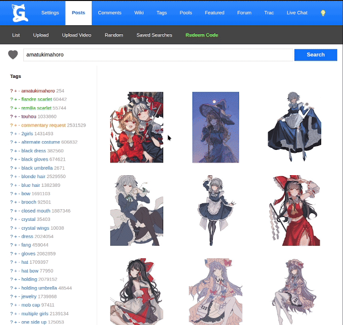

# Gelbooru Grid Favorites

Favorite posts straight from the thumbnail grid. Includes cached heart states, favorites sync, and cache import/export.

**Account access:** While you're logged in, the script automatically reads your API key and user ID from your [Gelbooru account settings](https://gelbooru.com/index.php?page=account&s=options). You don't need to paste credentials into the script. The API key stays in memory for the current page and is used only for requests to Gelbooru.

**No cloud backup:** The favorites cache is stored locally in your userscript manager. The script provides no cloud backup or automatic cross-device cache sync. Use **Export cache** to save a copy and **Import cache** to move it to another browser. Your favorites themselves remain on Gelbooru.

## Install

1. Install a userscript manager such as [Tampermonkey](https://www.tampermonkey.net/), [Violentmonkey](https://violentmonkey.github.io/), or [ScriptCat](https://scriptcat.org/).
2. Download the [userscript](https://github.com/jaratrozky/gelbooru-grid-favorites/releases/download/v1.0.0/gelbooru-grid-favorites.user.js) and import it into your manager, or create a script and paste [the source](gelbooru-grid-favorites.user.js). If upgrading, export your cache first and replace the existing script instead of enabling a second copy.
3. Open Gelbooru while logged in, then choose **Scrape favorites (full)** from the script's menu in your userscript manager.

No build step or dependencies to install.

## Use

Click a heart to favorite or unfavorite. A dot or exclamation mark means the state needs checking; click once to check it, then again to change it.

- **Scrape favorites (full)** visits all of your Gelbooru favorites pages, collects the image IDs, and rebuilds the local cache. Run it once to initialize the hearts, or later to reconcile the whole collection.
- **Quick refresh (newest pages)** scrapes your favorites pages from newest to oldest, collecting images that aren't already cached as favorites. It stops at the first page with no new images, the end of the collection, or 30 pages. It finds additions only; use a full scrape to pick up removals.
- Adding a favorite also upvotes the post. Unfavoriting does not undo votes.
- **Export**, **Import**, and **Restore previous cache** affect the local cache only.
